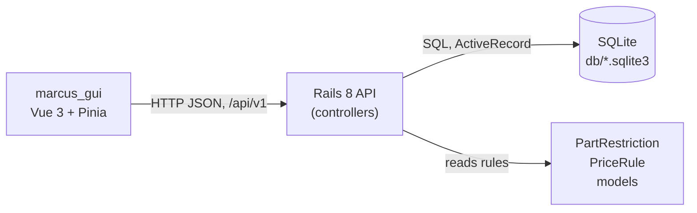

# Configurable Product Configurator — API

[](https://github.com/arkaitz97/marcus_api/actions/workflows/ci.yml)
[](LICENSE)

This is the backend of a bike configurator: it stores the catalogue (products,
parts and options), the rules that decide whether a configuration is valid and
what it costs, and the orders customers place. I built it as a Rails 8 JSON API
with a separate Vue admin ([marcus_gui](https://github.com/arkaitz97/marcus_gui))
because the rules have to be enforced server-side: a client can draw radio
buttons, but only the API can refuse an incompatible pair, report an out-of-stock
option, or price a combination the same way twice. The domain is small on
purpose. It is a complete vertical slice — schema, rules, HTTP contract, tests,
CI, container — not a shop.

## Architecture



- `products → parts → part_options` is the catalogue hierarchy. Requests nest in
  the same shape: `/products/:product_id/parts/:part_id/part_options`.
- `part_restrictions` and `price_rules` are top-level because each row joins two
  options that can live under different parts.
- `orders` and `order_line_items` snapshot a selection. The price is calculated
  at order time and stored on the order.
- The JSON contract is described below and asserted by the request tests.

## Run locally

Requirements: Ruby 3.4.13 (see `.ruby-version`), Bundler, SQLite development
libraries.

```bash
git clone https://github.com/arkaitz97/marcus_api
cd marcus_api
bundle install
bin/rails db:setup      # creates the database, loads the schema and the seeds
bin/rails server -p 3001
```

`bin/rails db:seed` creates one product, "Custom Bicycle", with five parts,
thirteen options, three restrictions and one price rule. The API answers on
`http://localhost:3001/api/v1`. `GET /up` is the health check.

## API

All routes are under `/api/v1`. Requests and responses are JSON. There is no
authentication: the app is a demo, and the admin UI is trusted.

| Resource | Routes |
|---|---|
| Products | `GET/POST /products`, `GET/PATCH/PUT/DELETE /products/:id` |
| Parts | `GET/POST /products/:product_id/parts`, `GET/PATCH/PUT/DELETE /products/:product_id/parts/:id` |
| Part options | `GET/POST /products/:product_id/parts/:part_id/part_options`, `GET/PATCH/PUT/DELETE .../part_options/:id` |
| Restrictions | `GET/POST /part_restrictions`, `GET/DELETE /part_restrictions/:id` |
| Price rules | `GET/POST /price_rules`, `GET/DELETE /price_rules/:id` |
| Orders | `GET/POST /orders`, `GET/PATCH/PUT/DELETE /orders/:id` |
| Configuration checks | `POST /product_configuration/validate_selection`, `POST /product_configuration/calculate_price` |

### Example: list products

```http
GET /api/v1/products
```

```json
[
  {
    "id": 1,
    "name": "Custom Bicycle",
    "description": "Build your own custom bicycle with various parts and options.",
    "created_at": "2026-11-24T12:28:41.280Z",
    "updated_at": "2026-11-24T12:28:41.280Z"
  }
]
```

### Example: validate a selection

`POST /api/v1/product_configuration/validate_selection` returns `200` with a
`valid` flag and the reasons. Invalid option ids are reported the same way.

```json
{ "selected_part_option_ids": [1, 4] }
```

```json
{ "valid": true, "errors": [] }
```

A conflicting pair returns `200` with `valid: false`:

```json
{
  "valid": false,
  "errors": [
    "Selection violates restriction: 'Mountain wheels' conflicts with 'Diamond'."
  ]
}
```

### Example: price a selection

```json
{ "selected_part_option_ids": [1, 4] }
```

```json
{ "total_price": "180.0" }
```

The total is the sum of the option prices plus every matching `price_rules`
premium. Money is serialised as a decimal string; the column type is
`decimal(10,2)`.

### Example: place an order

`POST /api/v1/orders` validates the selection, prices it, stores the order as
`pending` and returns `201` with the line items. The same validation that
`validate_selection` runs also protects order creation.

```json
{
  "order": {
    "customer_name": "Ane Etxeberria",
    "customer_email": "ane@example.com",
    "selected_part_option_ids": [1, 4]
  }
}
```

```json
{
  "id": 1,
  "customer_name": "Ane Etxeberria",
  "customer_email": "ane@example.com",
  "total_price": "180.0",
  "status": "pending",
  "created_at": "2026-11-24T12:29:17.463Z",
  "updated_at": "2026-11-24T12:29:17.463Z",
  "order_line_items": [
    {
      "id": 1,
      "order_id": 1,
      "part_option_id": 1,
      "part_option": {
        "id": 1,
        "name": "Full-suspension",
        "price": "130.0",
        "part_id": 1,
        "in_stock": true
      }
    }
  ]
}
```

Errors use `422` with `{"errors": [...]}` for rule violations and `404` with
`{"error": "..."}` for unknown ids.

## Tests

```bash
bin/rails db:test:prepare test
```

The suite is request-level (`ActionDispatch::IntegrationTest`) and uses fixtures
that mirror the seeds: every resource has at least one test that asserts status
and payload shape, plus the rule cases (restriction conflict, inverse rule,
stock, premium pricing). The CI workflow runs these tests, RuboCop and Brakeman.

## Deploy

The repository ships a production `Dockerfile` (multi-stage, Ruby 3.4.13,
Thruster on port 80) and a Kamal scaffold in `config/deploy.yml`. The scaffold
contains placeholders (`your-user`, `192.168.0.1`, `app.example.com`) and no
deployment runs from CI, so treat it as a starting point, not a live service.

To run the image by hand:

```bash
docker build -t marcus_api .
docker run -p 3000:80 -e RAILS_MASTER_KEY=<key from config/master.key> marcus_api
```

Production settings that matter:

- Create `config/master.key` from your own credentials, or set
  `RAILS_MASTER_KEY`. Never commit `config/master.key`.
- The production database is SQLite on the `marcus_api_storage` volume. That is
  fine for a single-instance demo; use PostgreSQL before running more than one
  app container.
- CORS in `config/initializers/cors.rb` allows `localhost:5173` only. Add the
  deployed admin origin before serving a real frontend.
- Set `RAILS_LOG_LEVEL=info` and keep `SOLID_QUEUE_IN_PUMA: true` as the scaffold
  does.

## Documentation

- [Design](docs/design.md): context, goals, non-goals, data model, alternatives.
- [ADR 0001](docs/adr/0001-pairwise-rule-engine.md): why compatibility and price
  rules are two pairwise tables.
- [ADR 0002](docs/adr/0002-order-lifecycle.md): why orders start `pending` and
  store their price.
- [Contributing](CONTRIBUTING.md) and [security policy](SECURITY.md).

## License

MIT. See [LICENSE](LICENSE).
